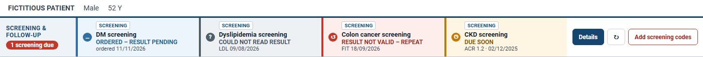

# Clinical meanings

This reference describes version 0.2.1. **Programme rule** means a local choice, not guideline text.

## Strip states

| State | Colour | Meaning | Doctor action |
|---|---|---|---|
| **DUE NOW** | Red | A required valid result is missing or expired | Order the test |
| **DUE SOON** | Amber | The interval ends within 30 days | Plan the test |
| **SCREENED** | Green | Screening is current | No action |
| **UP TO DATE** | Green | Follow-up is current | No action |
| **ORDERED – RESULT PENDING** | Blue | Ordered within 30 days, without a result | Wait for the result |
| **RESULT NOT VALID – REPEAT** | Red | The newest authorised result has no usable value | Repeat the test |
| **COULD NOT READ RESULT** | Dark grey | Important information could not be read | Select **↻** and do not assume clear or due |
| **NOT ELIGIBLE** | Grey | The patient is outside the pathway | Read the reason |
| **LOADING…** | Light grey | The Assistant is reading Raqeem | Wait |

**SCREENING** checks a patient without the relevant diagnosis. **FOLLOW-UP** checks a coded condition or current statin. Follow-up cells never offer screening codes.

For pathways with several tests, the order is:

1. **RESULT NOT VALID – REPEAT**
2. **DUE NOW**
3. **COULD NOT READ RESULT**
4. **ORDERED – RESULT PENDING**
5. **DUE SOON**
6. **SCREENED** or **UP TO DATE**

A missing or invalid test stays due even when another test cannot be read. An unread test prevents a green, pending, or due-soon result.

## What counts as a valid result

- Only authorised or dispatched results count.
- Cancelled and rejected orders do not count.
- Results from any Raqeem centre count.
- The result line must contain a usable number.
- Bounds such as `<3.0` and values with units can count.
- NA, blank, unavailable, and insufficient samples do not count.
- FIT can be positive or negative. The Assistant reads every line of the FIT report. A weak positive counts as positive. A FIT with no negative or positive line is not valid.
- The interval starts on the result date.
- Values are not rounded on the strip.

## Pathway rules

### DM

| Situation | Cell | Rule |
|---|---|---|
| Active E10–E14 | **Diabetes follow-up** | HbA1c every 6 months; every 3 months when HbA1c is 7% or higher. ADA 2026, 6.2 |
| Age 35 or older, no diabetes, not pregnant | **DM screening** | HbA1c or fasting glucose every 365 days. ADA 2026, 2.12b; yearly interval is a programme rule |
| Age under 35 | **NOT ELIGIBLE** | Age below 35 |
| Pregnant | **NOT ELIGIBLE** | Pregnancy |

Fasting glucose does not satisfy Diabetes follow-up.

### Dyslipidemia

| Situation | Cell | Rule |
|---|---|---|
| Active E78, current statin, or active E10–E14 | **Lipid follow-up** | Total cholesterol, LDL, HDL, and triglycerides every 365 days. ADA 2026, 10.16–10.17 |
| Men 35 or older, or women 45 or older | **Dyslipidemia screening** | All four tests every 365 days. Programme rule |
| Younger | **NOT ELIGIBLE** | Below the sex-specific screening age |

The cell is unreadable when the complete medicine list is unavailable. An unread page can contain a statin and change the pathway.

### Colon cancer

| Situation | Cell | Rule |
|---|---|---|
| Age 45–75 without a colon cancer record | **Colon cancer screening** | FIT every 365 days. USPSTF 2021 |
| C18–C20, Z85.03, or Z85.04 | **NOT ELIGIBLE** | Specialist follow-up, not FIT screening |
| Outside age 45–75 | **NOT ELIGIBLE** | Outside the screening age |

A positive FIT remains **SCREENED** and adds a red colonoscopy referral gap. Colonoscopy results are not available to the Assistant.

### CKD

The Assistant checks these situations in order:

| Situation | Cell | Rule |
|---|---|---|
| ESRD or dialysis | **NOT ELIGIBLE** | N18.6, Z99.2, or Z49 exclusion |
| Coded N18 at any age | **CKD follow-up** | ACR and serum creatinine at least yearly. ADA 2026, 11.1b |
| Active E10–E14 at any age | **Kidney follow-up** | ACR and serum creatinine yearly. ADA 2026, 11.1a |
| Under 18 without the above | **NOT ELIGIBLE** | Age below 18 |
| Hypertension, heart disease, stroke, or heart failure, recorded at two or more visits or marked as chronic in Raqeem | **CKD screening** | ACR and serum creatinine yearly. KDIGO 2024, PP 1.1.1.1 |
| None of these | **NOT ELIGIBLE** | No diabetes, and no hypertension or heart disease coded at 2 visits or marked chronic |

A hypertension or heart disease diagnosis recorded at one visit only, and not marked as chronic, does not start CKD screening. Other checks, such as the blood-pressure care gaps, still use that diagnosis.

Only the albumin/creatinine ratio counts as ACR. Only serum creatinine counts. A separate eGFR order does not count. CKD screening has no screening code.

## Pregnancy rule

This rule applies to women aged 12–55.

- Evidence can be a pregnancy visit flag, a pregnancy code, or positive hCG.
- Evidence no more than 294 days apart belongs to one pregnancy.
- A gestation code can set the pregnancy start date.
- Pregnancy remains current for 238 days from an unanchored start.
- Pregnancy remains current for 294 days from a gestation-anchored start.
- A later delivery, puerperium, or pregnancy-loss code ends the episode.
- If visit history is incomplete, DM screening becomes **COULD NOT READ RESULT**.
- Pregnancy-dependent care gaps stay hidden until not-pregnant status is clear.

## Care gaps

Red means act now. Amber means act soon or confirm first. A gap based on missing treatment appears only after the full relevant record was read.

### Order

| Action | When it appears | Source |
|---|---|---|
| Order or repeat HbA1c, lipid profile, ACR and creatinine | Follow-up is due or invalid | ADA 2026, 6.2, 10.16–10.17, 11.1a–11.1b |
| Order the follow-up test at the next visit | Follow-up is due within 30 days | Same source as the pathway |
| Order HbA1c or fasting glucose | DM screening is due or invalid | ADA 2026, 2.12b; programme rule |
| Order lipid profile | Dyslipidemia screening is due or invalid | Programme rule |
| Order or arrange FIT | Colon screening is due or invalid | USPSTF 2021 |
| Order or arrange ACR and creatinine | CKD screening is due or invalid | KDIGO 2024, PP 1.1.1.1 |
| Order lipid profile 4–12 weeks after a statin change | No suitable lipid result after a recent start or dose change | ADA 2026, 10.17 |

### Refer

| Action | When it appears | Source |
|---|---|---|
| Refer for colonoscopy within 6 months; do not repeat FIT | Positive FIT within 12 months and no colon cancer code | ACS 2026; USMSTF 2017, recommendation 2 |

### Treat

| Action | When it appears | Source |
|---|---|---|
| Start or review statin treatment | Diabetes age 40–75, ASCVD, selected CKD, or LDL at least 4.9 mmol/L; no current statin | ADA 2026, 10.18 and 10.26; KDIGO 2024, 3.15.1.1–3.15.1.2; 2026 ACC/AHA; Saudi 2022 |
| Intensify lipid-lowering treatment | Current statin and LDL above the relevant goal | ADA 2026, 10.21 and 10.27 |
| Intensify diabetes treatment | Coded diabetes with recent HbA1c at or above the age-adjusted goal | ADA 2026, 6.3a, 9.15, 9.20, and 13.7a |
| Review blood-pressure treatment | Coded hypertension with repeated high readings | ADA 2026, 10.4 and 10.6; AHA/ACC 2025 |
| Consider SGLT2 inhibitor | Eligible kidney or heart protection group without a current SGLT2 inhibitor | ADA 2026, 9.8, 10.40b, and 11.7a; KDIGO 2024, 3.7.1–3.7.2 |
| Consider ACE inhibitor or ARB | Confirmed albuminuria without current ACE inhibitor, ARB, or ARNI | ADA 2026, 11.6a; KDIGO 2024, 3.6.1–3.6.3 |

### Safety check

| Action | When it appears | Source |
|---|---|---|
| Repeat BP now; assess symptoms and intensify treatment | BP at least 180 systolic or 110 diastolic within 30 days | ADA 2026, 10.1; AHA/ACC 2025 |
| Avoid ACE inhibitor plus ARB | Both are current and overlap | KDIGO 2024, recommendation 3.6.4 |
| Stop, reduce, or monitor metformin | Current metformin with low eGFR | KDIGO 2022, recommendation 4.1.1 and PP 4.1.2–4.1.3 |
| Review systemic NSAID | Recent systemic NSAID with CKD evidence | KDIGO 2024, PP 4.1.1 and PP 4.1.3 |
| Review hypoglycaemia and consider deintensifying | Insulin or sulfonylurea with low HbA1c in an older adult, or eGFR below 30 | ADA 2026, 6.4 and 13.14a |

### Confirm diagnosis

| Action | When it appears | Source |
|---|---|---|
| Repeat HbA1c or fasting glucose | One abnormal diabetes result without a diabetes code | ADA 2026, 2.1b |
| Confirm diabetes before coding | Two qualifying abnormal diabetes results | ADA 2026, 2.1b |
| Repeat creatinine and ACR in 3 months | One abnormal kidney result without a CKD code | KDIGO 2024, PP 1.1.1.2 and PP 1.1.3.1 |
| Confirm CKD and stage before coding | Kidney abnormality lasting at least 90 days | KDIGO 2024, PP 1.1.1.2 and PP 1.1.3.1 |
| Confirm hypertension with home or ambulatory BP | Repeated high readings without a hypertension code | ADA 2026, 10.1; AHA/ACC 2025 |
| Confirm obesity before coding | Repeated BMI at least 30 without an obesity code | ADA 2026, 8.2a |

The Assistant never diagnoses or adds these diagnoses. The doctor confirms before coding.

## Results and graphs

- Bold red **H** or **L** means outside Raqeem's range.
- A black value is inside the range, or no clear range is available.
- **Could not read** means the result was unavailable. Select **↻**.
- The graph labels values exactly as reported.
- A light green band shows Raqeem's normal range.
- A dashed line shows a trend only with three numeric readings spanning at least 180 days.
- A hollow point is a bound, such as `<3.0`. Bounds do not enter the trend.
- A red hollow **NA** point has no usable value.

## Medicines

A medicine is current when it is not stopped and one condition is true:

- The order or start date is within 180 days.
- Its end date is today or later.
- It has no order or start date.

Medicine information supports statin, SGLT2 inhibitor, ACE inhibitor, ARB, metformin, NSAID, hypoglycaemia, PREVENT, and FRAX checks.

## Calculators

All calculator results use values from the last 12 months. A result is withheld when a required value is missing, old, bounded, or newer than an unread result.

### eGFR, CKD-EPI 2021

- Uses serum creatinine, age, and sex.
- Not calculated below age 18.
- Reports G1, G2, G3a, G3b, G4, or G5.
- Shows ACR category A1, A2, or A3 when available.

### FIB-4

- Uses age, AST, ALT, and platelets from the same day.
- Low risk: below 1.3, or below 2.0 after age 65.
- High risk: above 2.67.
- Values between the limits are indeterminate.

### Mentzer index

- Uses MCV divided by RBC from the same day.
- Calculated only when MCV is below 80 fL.
- Below 13 favours thalassaemia trait.
- Above 13 favours iron deficiency.
- Exactly 13 is indeterminate.

### PREVENT, 10-year risk

- Shows ASCVD, total cardiovascular disease, and heart-failure risk.
- Uses age, sex, diabetes, cholesterol, HDL, systolic BP, BMI, eGFR, treatment, statin, and smoking.
- The doctor must select smoking **Yes** or **No**.
- Smoking is not saved.
- Used only for ages 30–79 without known ASCVD or heart failure.
- Requires complete diagnoses, medicines, vitals, and laboratory information.

| ASCVD band | Result |
|---|---|
| Low | Below 3% |
| Borderline | 3% to below 5% |
| Intermediate | 5% to below 10% |
| High | 10% or higher |

**Limitation:** PREVENT research used United States adults. No study has validated it in Saudi patients.

### Saudi FRAX

- The Assistant does not calculate a FRAX score.
- **Open FRAX** opens the official Saudi tool in a new tab.
- The Assistant sends no patient information to FRAX.
- The doctor enters the values manually.
- Raqeem can supply age, sex, weight, height, glucocorticoids, rheumatoid arthritis, selected secondary causes, and the smoking choice.
- Previous fracture, parent hip fracture, alcohol, and bone density are not available.
- FRAX accepts ages 40–90.

## Privacy and warnings

- The Assistant reads the open patient's Raqeem record only.
- It sends no patient information to another website.
- It adds screening codes only after the doctor confirms.
- It keeps a complete reading in the current tab for up to 10 minutes.
- Closing the tab removes that reading.
- Information outside Raqeem is not available.
- **COULD NOT READ RESULT** is unknown, not clear and not due.
- Do not include patient information or Raqeem screenshots in a problem report.
