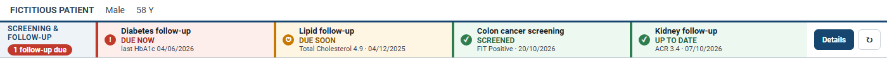
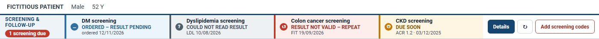
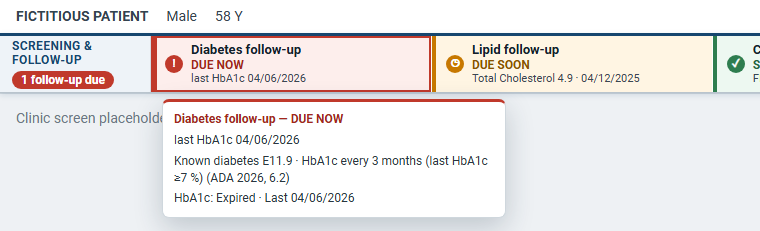
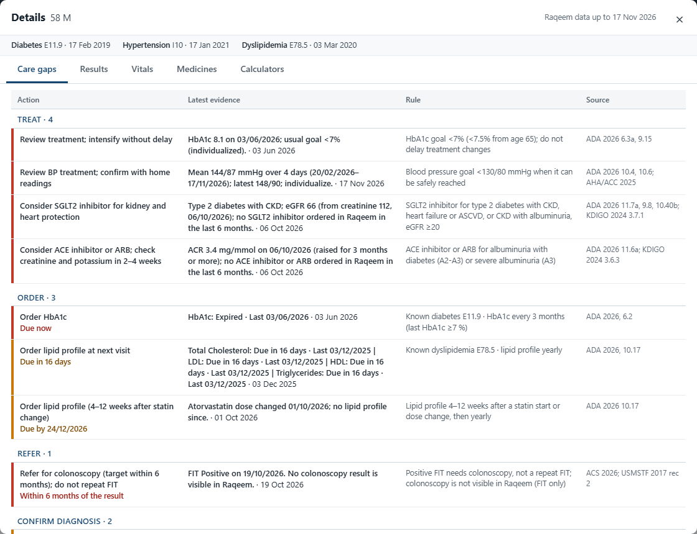
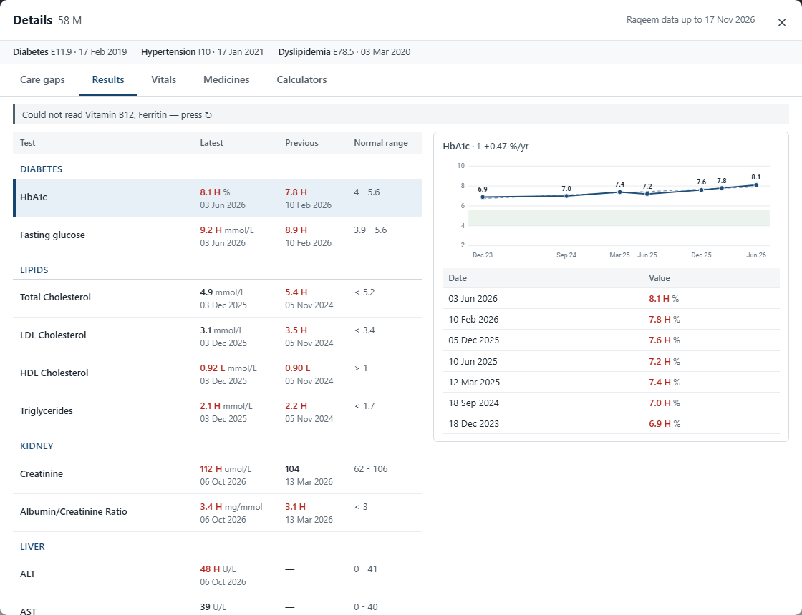
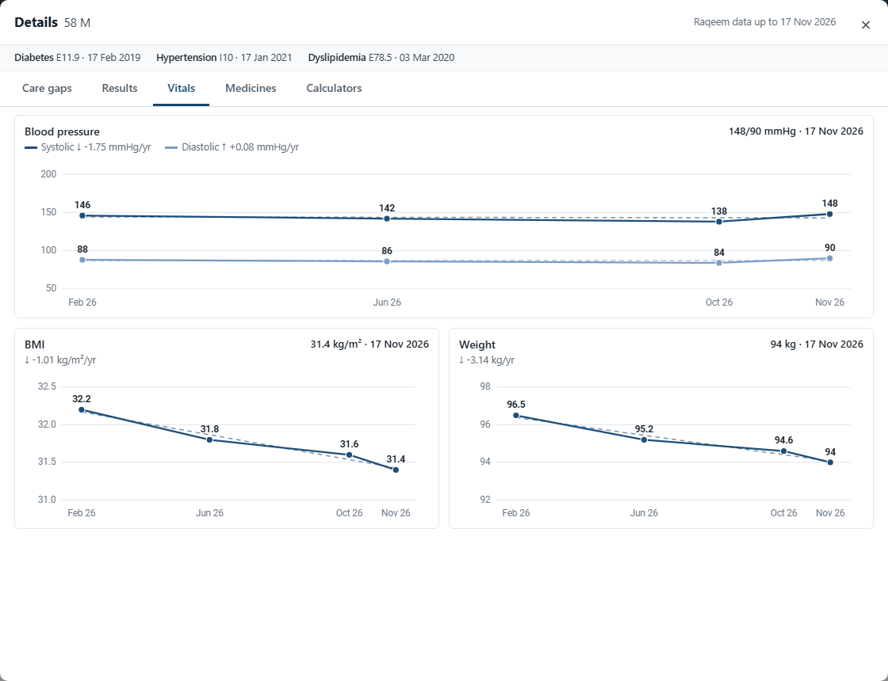
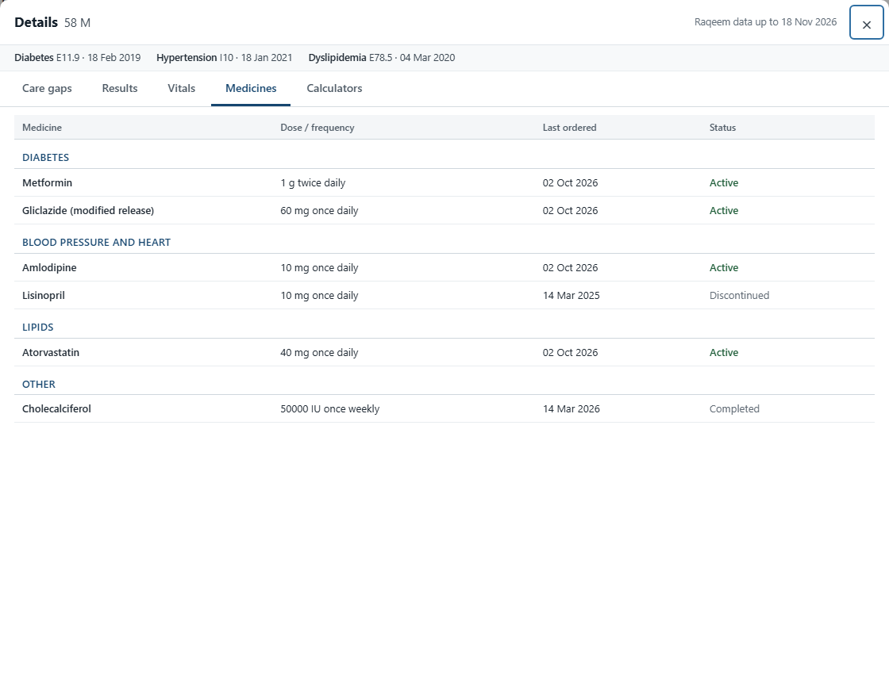
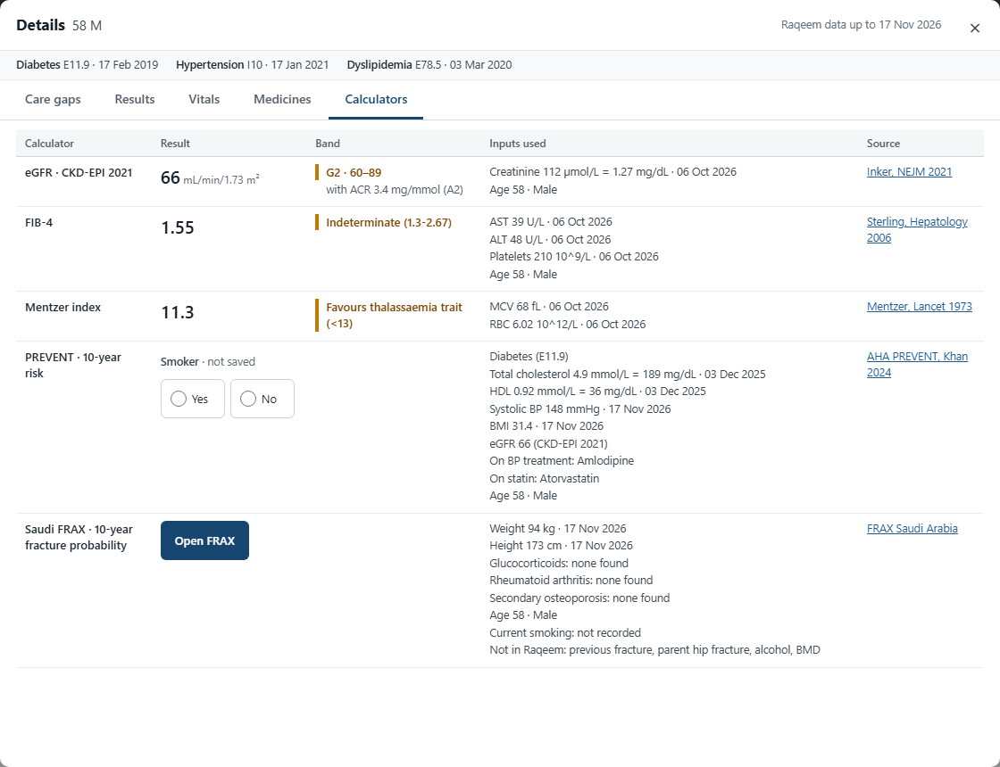
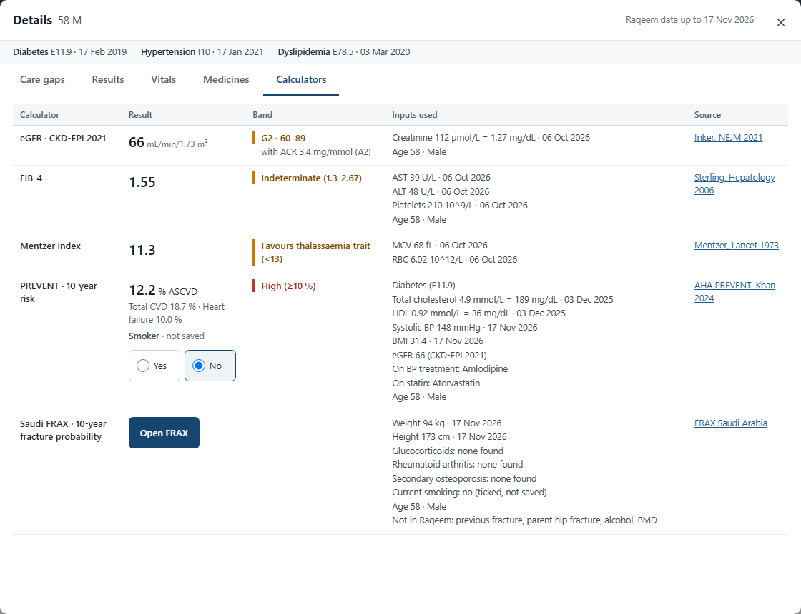

# Using Chronic Disease Assistant

Use this guide during daily work. All images use fictitious information.

## Start a patient review

1. Open one patient record in Raqeem.
2. Wait for the grey **LOADING…** cells to finish.
3. Find the **SCREENING & FOLLOW-UP** strip below the patient banner.

**Expected result:** Four cells show DM, Dyslipidemia, Colon cancer, and CKD.

Opening another patient closes **Details** and starts a new reading.

## Read the strip

1. Read the cell name. It ends in **screening** or **follow-up**.
2. Read the bold state.
3. Read the latest result, date, or reason below it. A long reason ends with **…**. Select the cell to read all of it.

- **Screening** means the Assistant is checking whether screening is due.
- **Follow-up** means a coded condition or current statin needs follow-up.
- Red means an action is due now.
- Amber means an action is due soon or needs confirmation.
- Green means screened or up to date.
- Grey means not eligible, still loading, or not fully read.

**Expected result:** Each cell gives one clear state. The left badge counts follow-up, screening due, or unread cells.

See [Clinical meanings](meanings.md#strip-states) for every state.

## Read the reason for a cell

1. Select the cell.
2. Read the reason and test dates.
3. Select the cell again to close it.

You can also move the pointer over a cell. Only one reason box stays open.

**Expected result:** The box shows the state, the rule, its source, and the relevant test dates.

## Open Details

1. Select **Details**.
2. Start with **Care gaps**.
3. Select another tab when needed.
4. Select **×** to close the window.

The window has five tabs:

### Care gaps

1. Read red actions first.
2. Read amber actions next.
3. Check the latest evidence.
4. Check the rule and source.

The tab groups actions as **Safety check**, **Treat**, **Order**, **Refer**, and **Confirm diagnosis**.

**Expected result:** Each row states the action, timing, evidence, rule, and source.

### Results

1. Find the required test group.
2. Compare the latest and previous values.
3. Select the test name.
4. Review the graph and earlier readings.

A bold red value with **H** or **L** is outside Raqeem's range. Values stay exactly as Raqeem reported them.

**Expected result:** The selected test shows a graph and all available readings from the last three years.

### Vitals

1. Review blood pressure.
2. Review BMI.
3. Review weight.

Each graph uses the latest reading from each day, up to four days within three years.

**Expected result:** Each graph shows the latest value, date, and trend when enough readings exist.

### Medicines

1. Find the group: **Diabetes**, **Blood pressure and heart**, **Lipids**, **Blood thinners**, **Thyroid**, or **Other**.
2. Review the active medicines at the top of each group.
3. Check the dose and frequency.
4. Check the last order date.
5. Check the status.

The list can show **Active**, **Completed**, **Not current**, or a stopped status from Raqeem.

**Expected result:** Each medicine appears once, with its most recent current order. If the same medicine has two active doses on the same day, both doses appear in the row. A group without medicines is not shown.

### Calculators

1. Check the values and dates used.
2. Select **Smoker: Yes** or **No** for PREVENT.
3. Read the PREVENT result and risk band.
4. Select **Open FRAX** when you need Saudi FRAX.
5. Enter the FRAX values yourself.

**Expected result:** Available rows show eGFR, FIB-4, Mentzer, and PREVENT results. FRAX opens separately.

PREVENT is not validated for Saudi patients. FRAX receives no patient information from the Assistant.

## Refresh the information

Use **↻** after a new result, order, diagnosis, or medicine change.

1. Select **↻**.
2. Wait for **LOADING…** to finish.
3. Recheck the affected cell or tab.

Also refresh when you see **COULD NOT READ RESULT** or **Could not read**.

**Expected result:** The Assistant reads the open patient again. Incomplete readings are never reused.

## Add screening codes

The button appears only for due DM, Dyslipidemia, or Colon cancer screening. It never appears for follow-up.

1. Check each due screening cell.
2. Select **Add screening codes**.
3. Read the proposed codes.
4. Select **OK** only when the codes are correct.
5. Check the Diagnosis list after the Assistant finishes.

If a code fails or cannot be confirmed, the Assistant shows a message naming that code.

The possible screening codes are:

| Screening pathway | Code |
|---|---|
| DM | Z13.1 |
| Dyslipidemia | Z13.6 |
| Colon cancer | Z12.1 |

CKD screening has no code to add.

The Assistant checks diagnoses before adding. It checks again afterwards to confirm what Raqeem saved.

**Expected result:** The Diagnosis list contains each code that Raqeem accepted. Any failed or unconfirmed code appears in a message.

If the patient, visit, or department changes, the Assistant stops adding more codes.

## Keyboard controls

| Place | Key | Result |
|---|---|---|
| Strip | Tab | Moves through cells and buttons |
| Strip cell | Enter or Space | Opens or closes its reason |
| Strip | Escape | Closes the reason |
| Details tabs | Left or Right arrow | Moves between tabs |
| Details tabs | Home or End | Moves to the first or last tab |
| Result test | Enter or Space | Shows its graph and readings |
| Details | Escape | Closes Details |

## If something looks wrong

1. Select **↻**.
2. Wait for the reading to finish.
3. Check the exact state again.
4. Check [Clinical meanings](meanings.md).
5. Send a [problem report](https://github.com/vBryx/chronic-disease-assistant/issues/new?template=problem.md) if the problem remains.

Do not send names, record numbers, national or iqama numbers, birth dates, phone numbers, or Raqeem screenshots.
